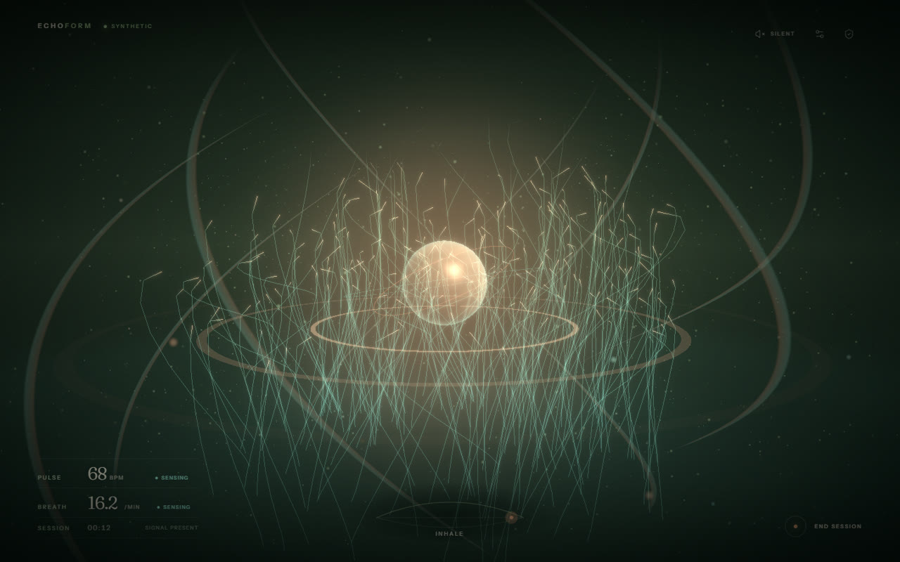
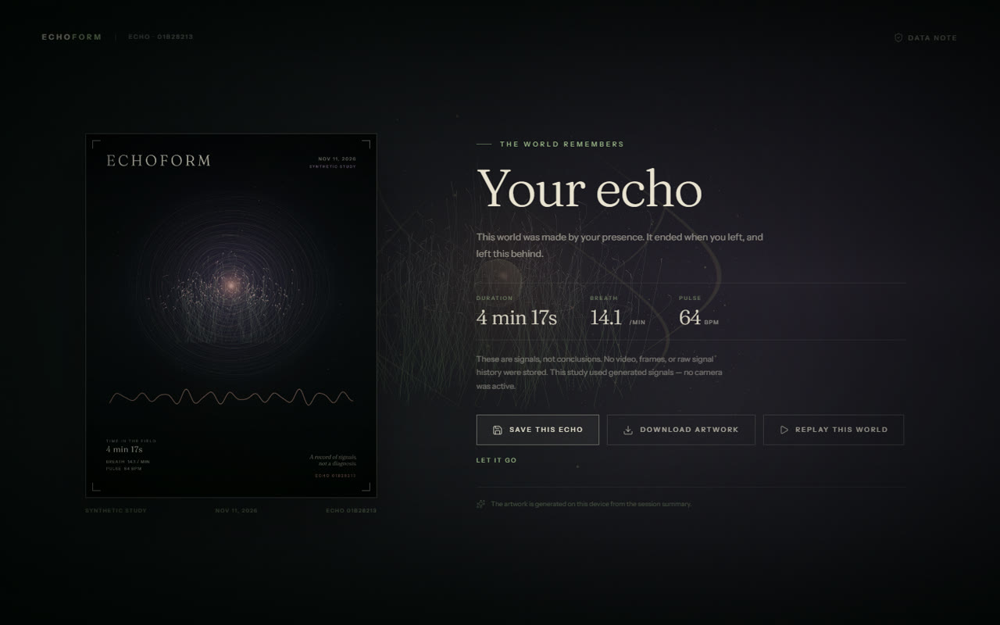

# ECHOFORM

**A world that exists only while you are present.** ECHOFORM turns live breathing and pulse measurements from the Presage SmartSpectra SDK into a generative 3D ecosystem. When you leave, the world contracts into an Echo Print.



## What it does

- **Live sensing:** Presage SmartSpectra measures breathing and pulse from your camera on-device. No video is recorded. Live mode requires a Presage API key.
- **A living world:** breath drives a particle field and flowing ribbons; pulse drives a shader core and expanding echo rings; a seeded organism grows through the session.
- **Adaptive sound:** a Web Audio soundscape follows breath and pulse (off by default).
- **Echo Print:** when you leave, the world contracts into a locally generated 1600×2000 PNG you can download.
- **Synthetic mode:** explore the full experience without a camera or API key.

## Setup

```bash
git clone https://github.com/Senthil455/EchoForm.git
cd EchoForm
npm install
npm run dev
```

This starts the Vite dev server and opens the Electron app.

### Build and package

```bash
npm run typecheck
npm run build
npm run pack:win
```

The Windows installer is written to `dist/`. The packaged Windows app has been smoke-tested in synthetic mode. macOS and Linux build scripts are included but have not been validated on those platforms.

### Live mode

1. Register for a Presage developer key at https://physiology.presagetech.com/.
2. Launch ECHOFORM, choose **Use my camera**, paste your key, and confirm the camera prompt.
3. The consent screen explains what is measured before the camera turns on.

You can store the key encrypted by your OS ("Remember on this device") or keep it session-only. Without a key, choose **Explore with synthetic signals** — the complete experience runs on generated signals, no camera required.

### Scripts

| Script | What it does |
|--------|--------------|
| `npm run dev` | Vite dev server + Electron |
| `npm run build` | Type-check (`tsc --noEmit`) + Vite production build |
| `npm run start` | Run the app (`electron .`) |
| `npm run typecheck` | Type-check only |
| `npm run pack:win` | Build a Windows distributor with electron-builder |
| `npm run pack:mac` | Build a macOS distributor with electron-builder |
| `npm run pack:linux` | Build a Linux distributor with electron-builder |

Platform tested: Windows 11 x64. The SmartSpectra SDK also supports macOS arm64 and Linux x64.

## Demo and screenshots

The screenshots below use generated signals so the experience can be reviewed without a camera or API key.

| Living world | The Echo Print |
| --- | --- |
|  |  |

Suggested 2–3 minute demo: introduce the consent screen and synthetic option; start a synthetic session and show breath/pulse responding in the world; end the session to reveal the Echo Print; save the echo, replay it without the camera, then show the archive and delete controls. If recording live mode, use your own valid Presage key and show camera consent before starting.

## Project docs

- [Product requirements (PRD)](docs/PRD.md)
- [Business requirements (BRD)](docs/BRD.md)
- [Technical design (TRD)](docs/TRD.md)
- [Architecture](docs/ARCHITECTURE.md)
- [Feature map](docs/FEATURES.md)
- [Camera consent and privacy](docs/PRIVACY.md)
- [Challenge submission draft](docs/SUBMISSION.md)

## Consent & privacy

- The camera is only requested after you choose **Use my camera** and confirm the operating-system prompt.
- ECHOFORM never records, stores, or uploads video. No raw signals are saved.
- No accounts, analytics, ads, crash reporter, or backend. The SDK contacts Presage only to validate your API key; optional aggregate SDK telemetry is off by default.
- Saved echoes hold only aggregate numbers, a date, and a random seed — no health data, no face data.
- Delete all local data from inside the app at any time.

See `docs/PRIVACY.md` for the full camera consent and data handling disclosure.

## Built with

Electron · React · TypeScript · Three.js · React Three Fiber · WebGL/GLSL · Web Audio API · Canvas 2D · Presage SmartSpectra SDK · Zustand · Vite.

## License

MIT

---

Built for the [Presage SmartSpectra SDK Challenge](https://dev.to/challenges/presage-smartspectra-sdk-challenge) — tag `#presagechallenge`.
