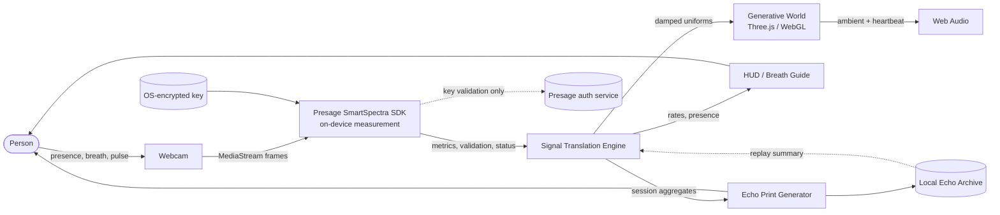
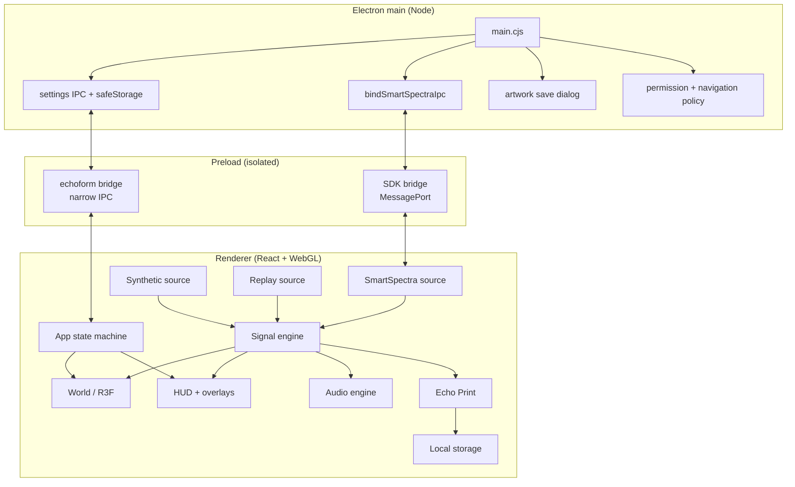
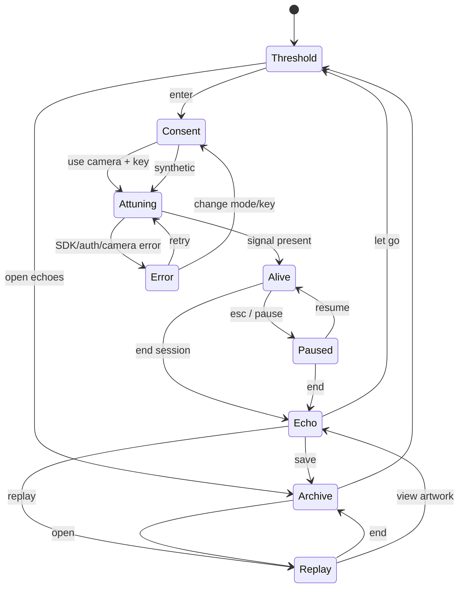
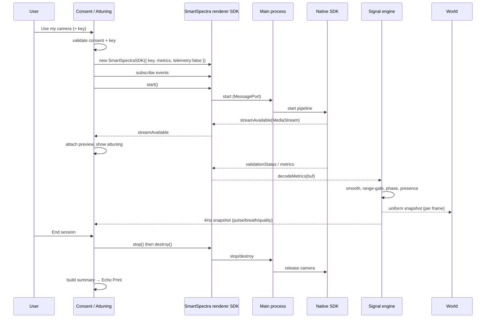
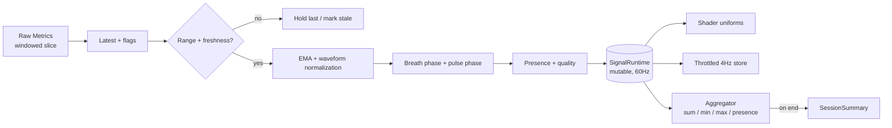
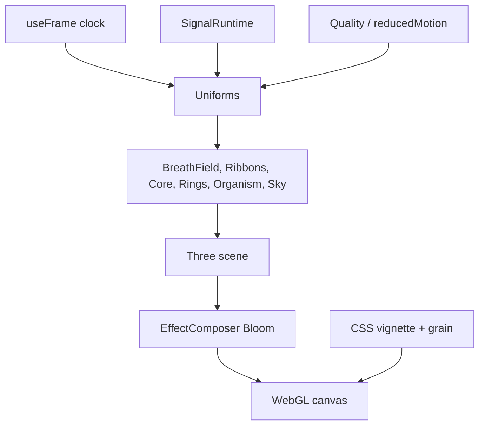
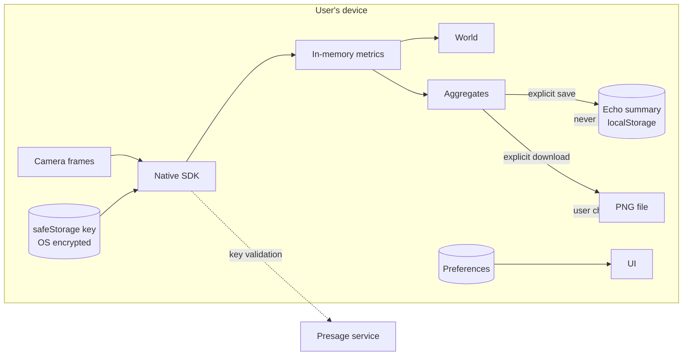
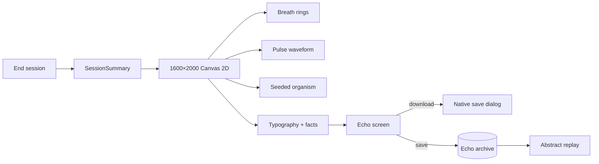
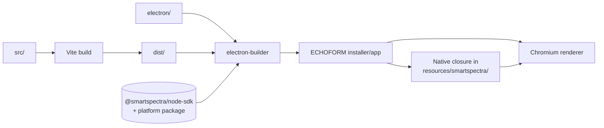

# ECHOFORM — Architecture

> Companion to [TRD](./TRD.md). This document shows the system shape, runtime flows, and module boundaries.

---

## 1. System context



**Trust boundary:** camera frames and metrics stay inside the desktop app. The only network call is the SDK's key validation/gating.

---

## 2. Process and module map



### 2.1 File map (planned)

```
electron/
  main.cjs                 # window, permissions, SDK IPC, settings IPC
  preload.cjs              # composes SDK preload + echoform bridge
src/
  main.tsx                 # React root
  App.tsx                  # phase machine, overlays, global shortcuts
  styles/
    tokens.css             # palette, type, spacing
    app.css                # layout + components
  state/
    store.ts               # Zustand app store
    persistence.ts         # prefs + echoes (localStorage)
    types.ts               # shared app types
  signals/
    types.ts               # SignalFrame, SessionSummary
    runtime.ts             # mutable 60Hz runtime + 4Hz external store
    engine.ts              # smoothing, phase, presence, summary aggregation
    smartspectra.ts        # live SDK lifecycle + event decoding
    synthetic.ts           # synthetic + replay generators
    useSignal.ts           # React hooks (throttled snapshots)
  world/
    WorldCanvas.tsx        # Canvas, scene, camera, postprocessing
    Scene.tsx              # world composition, uniforms, animation loop
    palettes.ts
    math.ts                # PRNG, easing, helpers
    shaders.ts             # GLSL strings
    components/
      BreathField.tsx
      Ribbons.tsx
      Core.tsx
      PulseRings.tsx
      PresenceOrganism.tsx
      SporeDust.tsx
      GroundPool.tsx
      Sky.tsx
      CameraRig.tsx
  audio/
    EchoAudio.ts
  artwork/
    generateEchoPrint.ts   # Canvas 2D composition
  components/
    Threshold.tsx
    Consent.tsx
    Attuning.tsx
    WorldHUD.tsx
    BreathGuide.tsx
    PauseSheet.tsx
    PrivacyPanel.tsx
    EchoSummary.tsx
    Archive.tsx
    Settings.tsx
    EchoMark.tsx
    ErrorBoundary.tsx
    Toast.tsx
  lib/
    api.ts                 # bridge wrappers + browser fallbacks
    format.ts              # time, rate formatting
    useFocusTrap.ts
    useReducedMotion.ts
  types/
    echoform.d.ts          # window bridge typings
docs/
  BRD.md PRD.md TRD.md ARCHITECTURE.md FEATURES.md PRIVACY.md SUBMISSION.md
```

---

## 3. Experience state machine



State is owned by `useAppStore`:

```ts
type Phase = 'threshold' | 'consent' | 'attuning' | 'alive' | 'echo' | 'archive' | 'replay';
type Mode = 'live' | 'synthetic';

interface AppState {
  phase: Phase;
  mode: Mode;
  validation: string;
  error: AppError | null;
  summary: SessionSummary | null;
  echoes: SessionSummary[];
  prefs: Preferences;
  ...
}
```

---

## 4. Live sensing sequence



---

## 5. Signal engine data flow



### 5.1 Why a separate mutable runtime

React state at 60 Hz would re-render the tree and the WebGL scene constantly. Instead:

- The engine writes to a plain mutable object (`signalRuntime.current`).
- `useFrame` reads it directly and updates shader uniforms — no React renders.
- The UI subscribes through a small external store that emits at 4 Hz for numbers/hints.
- Zustand is used for low-frequency app state (phase, prefs, errors, summary), not for signal frames.

This keeps the render loop independent of React and avoids GC churn.

---

## 6. World render pipeline



### 6.1 Uniform contract

All world components read from a shared mutable `WorldSignals` object, updated once per frame in `Scene.tsx`:

```ts
interface WorldSignals {
  t: number;
  breath: number;       // -1..1
  breathRate: number;   // 0..1 normalized
  breathAmp: number;    // 0..1
  pulse: number;        // 0..1 beat envelope
  pulseRate: number;    // 0..1 normalized
  presence: number;     // 0..1
  growth: number;       // 0..1 session progress
  awake: number;        // 0..1 awakening
  echo: number;         // 0..1 contraction
  hue: number;          // 0..1 slow drift
}
```

`Scene.tsx` owns one `useFrame` and updates uniforms on memoized refs. Components never subscribe to React state per frame.

---

## 7. Persistence and privacy boundaries



**Stored:** preferences, saved echo summaries (aggregates + seed + date), OS-encrypted API key (opt-in), downloaded artwork (user chosen).
**Never stored:** video frames, raw metrics, landmarks, expressions, audio, API key in plaintext, analytics.

---

## 8. Echo Print pipeline



The artwork is fully deterministic from the summary; no external AI service or network is involved.

---

## 9. Failure and recovery paths

| Failure | Detection | Recovery |
| --- | --- | --- |
| Camera denied | `getUserMedia` / SDK start error | Explain, offer retry, synthetic mode |
| Camera busy | `kInputUnavailable` | Close other app / retry |
| Invalid key | `kAuthenticationFailed` | Edit key, retry, synthetic |
| No credits | `kCreditExhausted` | Link to Presage, synthetic |
| Offline | `kNetworkError` | Explain gating; retry, synthetic |
| Poor signal | `validationStatus` | Hints; continue with ambient fallback |
| Camera unplugged | track ended / error | Pause world, offer reset |
| Main process stall | renderer `sendTimeoutMs` | Surface timeout; reset |
| GPU context lost | `webglcontextlost` | Reload scene/offer restart |
| Storage corruption | JSON parse failure | Reset that key, preserve other data |
| safeStorage unavailable | main returns unavailable | Session-only key; explain |

All recoveries preserve the user's ability to leave and delete data.

---

## 10. Build and runtime topology



- Development: Vite dev server + Electron loading `ECHOFORM_DEV_URL`.
- Production: `dist/index.html` loaded from `file://`; relative base.
- Packaging: native closure outside asar; `SMARTSPECTRA_CAPI_PATH` resolved in main before requiring the binding.

---

## 11. Module ownership and boundaries

| Module | Owns | Must not do |
| --- | --- | --- |
| `electron/main.cjs` | window, permissions, native paths, safeStorage, file saves | render UI, hold signal state |
| `electron/preload.cjs` | narrow bridge + SDK preload composition | expose Node globals |
| `signals/smartspectra.ts` | SDK lifecycle, event decoding | persist metrics |
| `signals/engine.ts` | smoothing, phases, presence, aggregation | touch DOM or Three |
| `signals/runtime.ts` | 60Hz mutable state + 4Hz notifications | own app phase |
| `world/*` | rendering, shaders, visual mapping | access camera or storage |
| `audio/*` | synthesis | request microphone |
| `artwork/*` | deterministic PNG composition | upload or call network |
| `components/*` | UI, accessibility, copy | contain hidden data collection |
| `state/store.ts` | app phase, prefs, summaries | hold per-frame signal data |

---

## 12. Performance strategy

1. **GPU-first:** signal response lives in shader uniforms, not React.
2. **One frame loop:** scene-level `useFrame` updates all uniforms.
3. **Budgeted particles:** 48k high / 32k medium / 18k low.
4. **DPR cap:** 1.75.
5. **No textures:** all procedural; avoids decode and memory.
6. **Cheap postprocessing:** bloom only; vignette/grain in CSS.
7. **Throttled UI:** 4 Hz snapshots; numbers animate with CSS transitions.
8. **Adaptive quality:** frame-time monitor steps down particles/bloom.
9. **Bounded arrays:** no unbounded waveform history; summary aggregates only.
10. **Lazy overlays:** heavy panels mount only when open.

---

## 13. Deployment checklist

- [ ] `npm install` on a clean machine.
- [ ] `npm run typecheck`.
- [ ] `npm run build`.
- [ ] `npm run dev` with synthetic mode.
- [ ] `npm run dev` with live mode and valid key.
- [ ] `npm run pack:win`; launch installer; verify native DLLs in `resources/smartspectra/`.
- [ ] Camera permission prompt appears; LED turns off after end.
- [ ] Delete-all removes saved echoes and key.
- [ ] No key or metrics in logs.
- [ ] Demo video recorded from the packaged or dev app with live signals.
