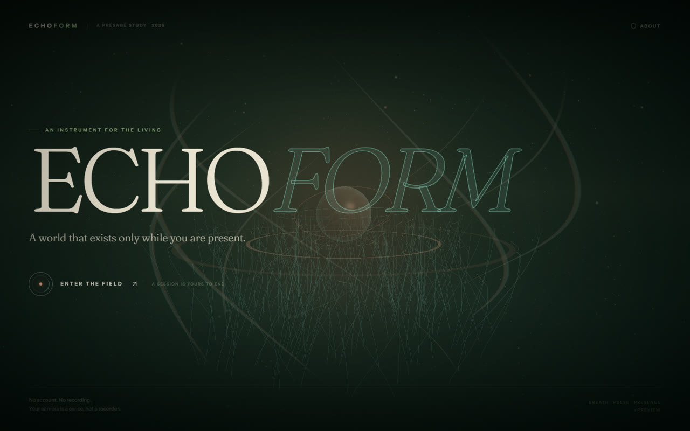
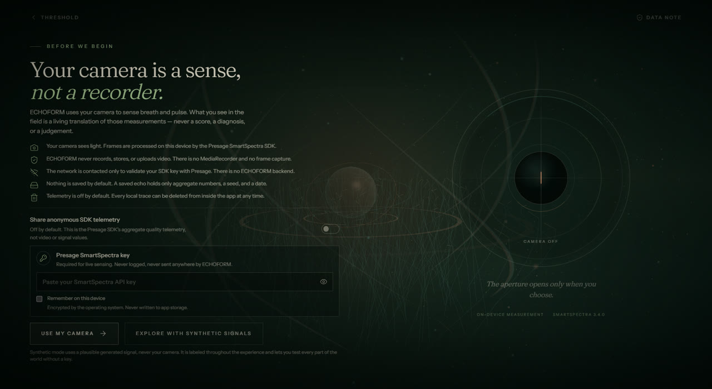
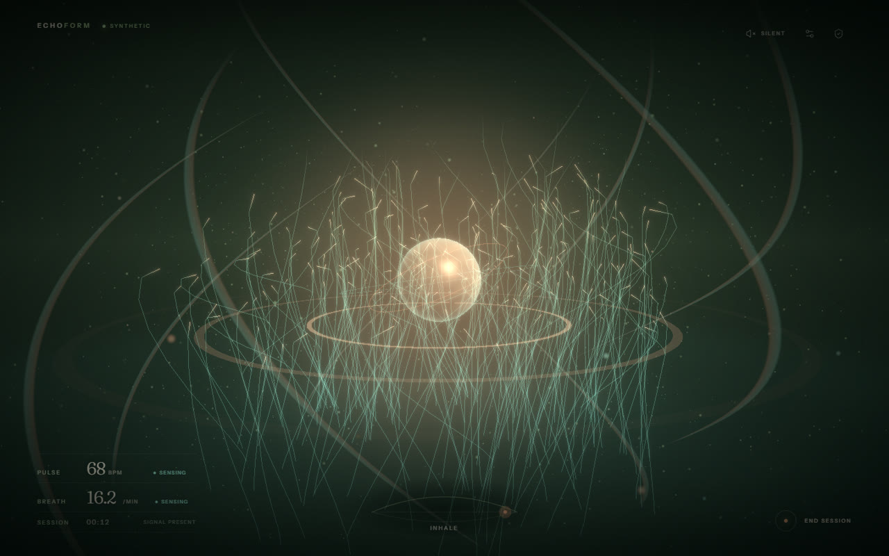
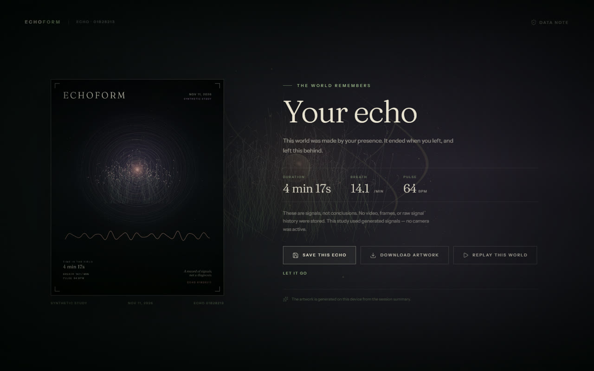
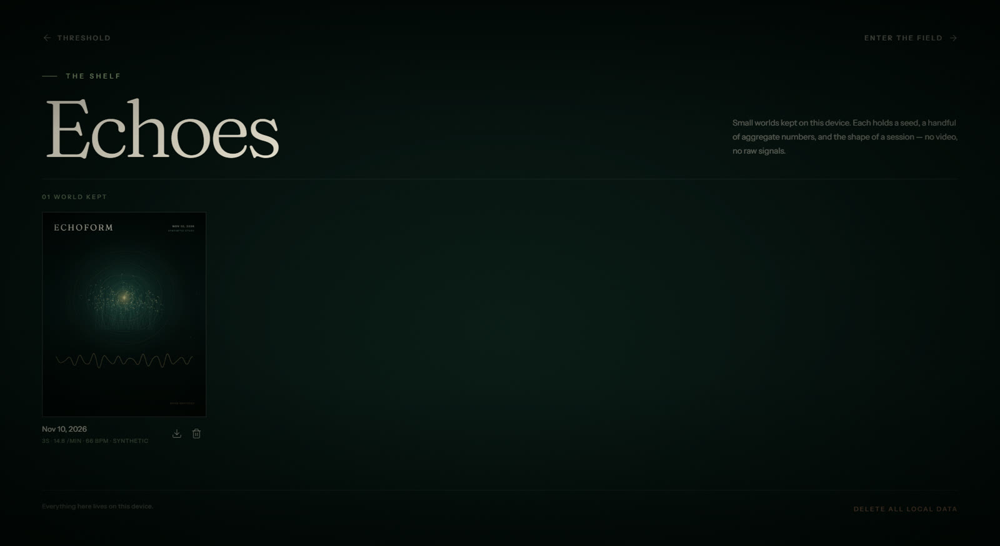

# ECHOFORM — DEV Challenge Submission Draft

> **Challenge:** Presage SmartSpectra SDK Challenge
> **Tag:** `#presagechallenge`
> **Prize categories:** Best Overall Human-Sensing Experience · Most Creative or Delightful Use · Best Thoughtful Real-World Use
> **Status:** Draft, screenshots, and Windows installer are ready. Remaining before publishing: record the public demo video with a confirmed live face/vital reading, replace the video placeholder, and run the final incognito link check.

---

## ECHOFORM: A world that exists only while you are present

**What if your presence was the only control a computer needed?**

ECHOFORM is a desktop experience built with the Presage SmartSpectra SDK. You sit in front of a camera. A dark, empty world waits. As the SDK measures your breathing and pulse, light gathers, a luminous organism begins to grow, particles move with your breath, and a warm core beats with your heart.

There is nothing to click. No score, no dashboard, no diagnosis. When you leave, the world ends and leaves behind a single artifact: an **Echo Print** generated from the signals that made that particular place.

> **A world that exists only while you are present.**

---

## What I built

ECHOFORM is a complete Electron + React + Three.js application, not a mockup.

- **Live sensing:** Presage SmartSpectra measures breathing and pulse from the camera on-device.
- **A living world:** breath drives thousands of particles and flowing ribbons; pulse drives a shader core and three expanding echo rings; a seeded organism grows over the session.
- **Adaptive sound:** an original Web Audio soundscape follows breath and pulse. Off by default.
- **An ending:** the session contracts into a locally generated 1600×2000 Echo Print, downloadable as a PNG.
- **A memory:** optionally save a small aggregate summary and replay the world later — without the camera.
- **A safe path:** synthetic mode lets anyone explore the full experience without a camera or API key.

No video is recorded. No raw signals are saved. No accounts. No backend.

---

## Demo

**Video:** [Add the public demo video link after recording — shot list in `docs/DEMO_VIDEO.md`]

**Repository:** https://github.com/Senthil455/EchoForm

**Setup:** see the README. In short:

```bash
npm install
npm run dev
```

Live mode needs a Presage API key from <https://physiology.presagetech.com/>. You can paste it in the app; it is encrypted with the OS keychain when you choose "remember". If you do not have a key, choose **Explore with synthetic signals** to see the complete experience. The packaged Windows build passed synthetic and live-startup smoke tests with a valid key. The SDK stayed active during the live smoke test, but face detection and physiological readings were not confirmed in the test environment.

**Platform tested:** Windows 11 x64. The SDK also supports macOS arm64 and Linux x64.

### Demo video plan (2:45, 1080p, 16:9)

The final cut must contain **one uninterrupted live segment** with a valid Presage key: the HUD breath/pulse values must change and the world must visibly answer them. Synthetic footage is allowed, but it must stay labeled `SYNTHETIC STUDY` on screen. Never show the key, a personal file, or a previously saved personal echo.

| Time | Shot | What the viewer sees |
| --- | --- | --- |
| 0:00–0:10 | Threshold | Dormant world, wordmark, "A world that exists only while you are present." |
| 0:10–0:28 | Consent | Camera aperture, plain-language data note, synthetic and camera choices. |
| 0:28–0:42 | Synthetic | The complete world on generated signals, clearly labeled. |
| 0:42–0:55 | Live start | Key already entered; **Use my camera**, OS prompt, camera preview. |
| 0:55–1:12 | Attuning | Ring fills, validation hints, first breath and pulse values. |
| 1:12–1:42 | Breath | Particles contract on inhale, release on exhale; ribbons follow. |
| 1:42–2:10 | Pulse | Core blooms per beat; three rings expand; optional sound. |
| 2:10–2:24 | Growth | The seeded organism has visibly unfolded. |
| 2:24–2:38 | End | World contracts into the Echo Print. |
| 2:38–2:52 | Save + replay | Save the aggregate echo; replay without the camera; show the archive. |
| 2:52–3:00 | Close | "No score. No diagnosis." / title line. |

Recording notes: use a session-only key, even front lighting, a plain background, OBS at 1080p, and no notifications. Blur the camera preview in post if you prefer not to appear. Full checklist and narration: `docs/DEMO_VIDEO.md`.

### What is verified today

| Check | Result |
| --- | --- |
| Synthetic threshold → consent → attuning → alive → echo → save | Passed in development and in the packaged Windows app |
| Replay → archive → delete controls | Passed in development; archived echoes replay without the camera |
| Native Echo Print save through the Electron dialog | Passed in the packaged Windows app |
| Invalid API key error and SDK teardown | Passed; camera stops, no frame-loop spam |
| Live SDK startup with a valid key | Exercised; the SDK stayed active |
| Live face detection and physiological readings | Not yet confirmed in the test environment |
| `npm run typecheck` / `npm run build` | Passed |
| Windows installer | Rebuilt with app icon; packaged synthetic flow and echo save re-checked |

### Screenshots

| The threshold | Consent before camera |
| --- | --- |
|  |  |
| **The living world** | **Your echo** |
|  |  |

All screenshots use synthetic signals and are labeled as such in the app.



The echo shelf keeps only small aggregate worlds on this device — a seed, a handful of numbers, and the shape of a session. No video, frames, or raw signals.

---

## How ECHOFORM uses the SmartSpectra SDK

The app uses the official Node/Electron SDK:

```ts
import {
  SmartSpectraSDK,
  MetricType,
} from '@smartspectra/node-sdk/renderer';
import { decodeMetrics } from '@smartspectra/node-sdk/messages';

const sdk = new SmartSpectraSDK({
  apiKey,
  requestedMetrics: [
    MetricType.CHEST_BREATHING,
    MetricType.ABDOMEN_BREATHING,
    MetricType.BREATHING_RATE,
    MetricType.PULSE_RATE,
  ],
  enableTelemetry: false, // ECHOFORM default
  sendTimeoutMs: 120_000,
});

const stream = await navigator.mediaDevices.getUserMedia({
  audio: false,
  video: { width: { ideal: 640, max: 640 }, height: { ideal: 480, max: 480 }, frameRate: { ideal: 30, max: 30 } },
});
preview.srcObject = stream;
sdk.useMediaStream(stream); // host owns and stops this stream
sdk.on('metrics', (buf) => {
  const m = decodeMetrics(buf);
  engine.ingest(m);
});
sdk.on('validationStatus', (code, ts, hint) => { engine.setValidation(code, hint); });
sdk.on('error', (code, message, retryable) => { /* human guidance */ });

await sdk.start();
```

The live signals and their visual mapping:

| SmartSpectra signal | What it does in ECHOFORM |
| --- | --- |
| Breathing waveform / rate | Contracts the particle field on inhale, releases it on exhale; waves the ribbons; opens the ambient filter |
| Pulse rate / confidence | Blooms the core once per beat; sends out echo rings; sets the heartbeat tempo |
| Presence / signal quality | Fades the world when the signal is lost; recovers gently |
| HRV (stretch) | Not used by the current world; the echo schema reserves an optional aggregate field for a future HRV layer |
| Face expression (optional, opt-in) | A subtle, unlabeled atmospheric tint in the sky; no emotion category is displayed or stored |

The SDK measures on-device. Live SDK use contacts Presage for authentication and required resources. Optional SDK diagnostics are off by default; if enabled, they include device, session, performance, and validation details, not video or measured values. Authenticated requests may be associated with the Presage account. **The world is driven by live signals, not a prerecorded loop.**

---

## The idea: signals, not conclusions

Most camera-sensing apps turn a person into a dashboard. ECHOFORM deliberately refuses that.

It does not tell you whether you are stressed, calm, healthy, or happy. It does not give you a score. It uses measured signals as **creative material** — the way wind uses a field. The only claims it makes are visual: this is what your breath did to the light; this is the rhythm your pulse gave the core.

That restraint is the product. It makes the experience safe to try, easy to trust, and unusual enough to remember.

---

## The experience, in five moments

1. **The threshold** — a dark world, a wordmark, one invitation.
2. **The consent** — a camera aperture, a plain-language data note, and a choice. Camera or synthetic. Nothing starts until you decide.
3. **The attunement** — the SDK finds your signal. The ring fills. Hints appear only when they help.
4. **The world** — breath becomes wind; pulse becomes light. A seeded organism grows. You do nothing.
5. **The echo** — the world contracts into an artwork. Keep it, download it, replay it, or let it go.

---

## Consent and data handling

**Camera consent**

- The camera is requested only after the consent screen, a key, and the explicit "Use my camera" action.
- A live preview shows what the camera sees.
- The camera is released on session end, window close, and quit.
- Choosing synthetic mode never requests the camera.

**What is processed**

- Camera frames are processed on-device by the Presage SmartSpectra SDK.
- ECHOFORM does not record, store, or upload video or audio.
- Raw metric payloads exist in memory during the session and are discarded at the end.

**What is stored**

- Preferences (sound, reduced motion, telemetry, expression weather, last mode) in local storage.
- If you save an echo: date, duration, average pulse, average breathing rate, optional HRV, presence ratio, variability, a random seed, palette index, source label, schema version. No raw signals, no video, no face landmarks, no expression data.
- If you choose "remember": the API key, encrypted by Electron `safeStorage` (OS keychain/DPAPI). Otherwise it is session-only.
- A downloaded Echo Print PNG, saved wherever you choose. ECHOFORM does not re-read it.

**Retention and deletion**

- Unsaved sessions are discarded.
- Saved echoes stay until you delete them individually or choose **Delete all local data**.
- Delete-all removes saved echoes, preferences, and the stored key, then returns to the threshold.
- Exported artwork is yours to manage.

**Sharing**

- ECHOFORM has no backend, analytics, ads, crash reporter, or accounts.
- Presage authenticates the API key and may serve required SDK resources. If you opt in, the SDK may send device/session diagnostics over an authenticated channel; these exclude video frames and measured vital values, and may be associated with the Presage account.
- No AI services are used. The Echo Print is generated locally with Canvas 2D.

**Optional SDK diagnostics**

- Off by default (`enableTelemetry: false`).
- If enabled, Presage's SDK may send device/SDK details, session shape, performance counters, validation counts, coarse error codes, and timestamps. Session diagnostics exclude raw video and measured vital values. Authenticated requests may be associated with the Presage account; ECHOFORM does not call the SDK's device-readiness report API.
- You can turn it off at any time.

Full disclosure: `docs/PRIVACY.md`. The consent screen shows the same commitments before camera access.

---

## Prize categories

- **Most Creative or Delightful Use** — a new interaction category: presence as the only controller, a world that exists only while you are there.
- **Best Thoughtful Real-World Use** — a non-clinical, consent-first pause from screen work, with data minimization and deletion built in.
- **Best Overall Human-Sensing Experience** — the same build; live breath and pulse drive distinct visual and audio layers.

---

## Built with

Electron · React · TypeScript · Three.js · React Three Fiber · WebGL/GLSL · Web Audio API · Canvas 2D · Presage SmartSpectra SDK · Zustand · Vite.

---

## What I learned

- Physiological signals are not clean control inputs. The interesting design work is in the smoothing, the fallbacks, and the honesty about uncertainty.
- Camera consent is not a checkbox. It is a scene with a preview, a clear explanation, and an exit.
- The most memorable use of a sensing SDK may not be a measurement at all. It may be a world that answers back.

---

## Try it

```bash
git clone https://github.com/Senthil455/EchoForm.git
cd EchoForm
npm install
npm run dev
```

Choose **Explore with synthetic signals** for the full experience without a key, or paste a Presage API key and choose **Use my camera**.

If you build something with a camera, give the person a way to leave. Then make leaving beautiful.

`#presagechallenge`

---

## Submission checklist

- [x] DEV post draft uses the required template and includes `#presagechallenge`
- [x] Repository is public and contains setup instructions
- [ ] Demo video is public and shows live Presage signals
- [x] Consent and Data Handling section included
- [x] Prize categories noted
- [x] No secrets, API keys, or personal data in the repository
- [ ] Final video and transcript checked for secrets and personal data
- [ ] Live face detection and physiological readings confirmed on the demo machine
- [x] Packaged app smoke-tested (synthetic and live startup)
- [x] Windows installer built with the app icon
- [x] Screenshots and demo-video plan included
- [ ] Optional agent session uploaded and set to public
- [ ] Links tested in an incognito window
- [ ] Public demo link replaces the placeholder above
